

  <a href="https://sevlegend.com/?page=programs">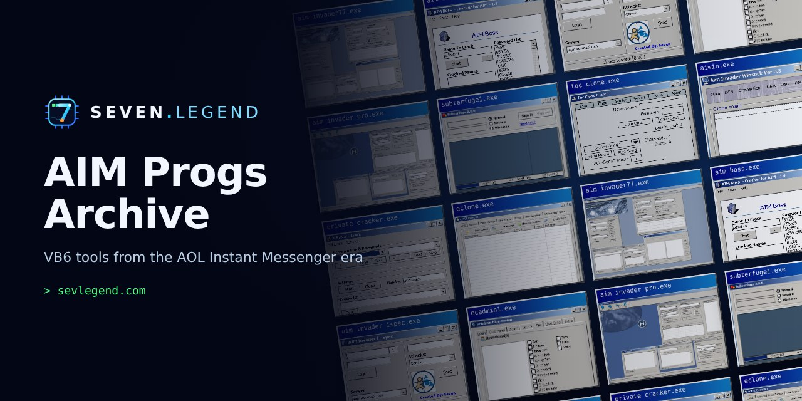</a>

<h1 align="center">AIM Progs Archive</h1>

  Visual Basic tools from the AOL Instant Messenger era, built by <b>Seven</b>. 
  <a href="https://sevlegend.com"><b>sevlegend.com</b></a> ·
  <a href="https://sevlegend.com/?page=programs">Full program gallery</a> ·
  <a href="https://sevlegend.com/?page=codes">Source library</a> ·
  <a href="https://sevlegend.com/?page=about">The story</a>

---

## What this is

In the early 2000s, a whole underground scene grew up around AOL Instant Messenger: kids writing **"progs"** in Visual Basic. Punters, clone loaders, chat bots, crackers, admin panels. Prog sites traded them, screen names were reputations, and a lot of us learned to program by figuring out how AIM worked and building something that did what the official client wouldn't.

I was one of those kids. This repo archives the programs I built. Some drove the AIM client window by window; others talked to AOL's servers directly over Winsock, with clone loaders, proxy managers and rate-limit handling.

These days I write C#, PHP and AI-assisted tools for a living. The archive, the source library and the rest of the story live at **[sevlegend.com](https://sevlegend.com)**.

## The programs

<table>
<tr>
<td align="center" valign="top"><b>AIM Invader 7.7</b>  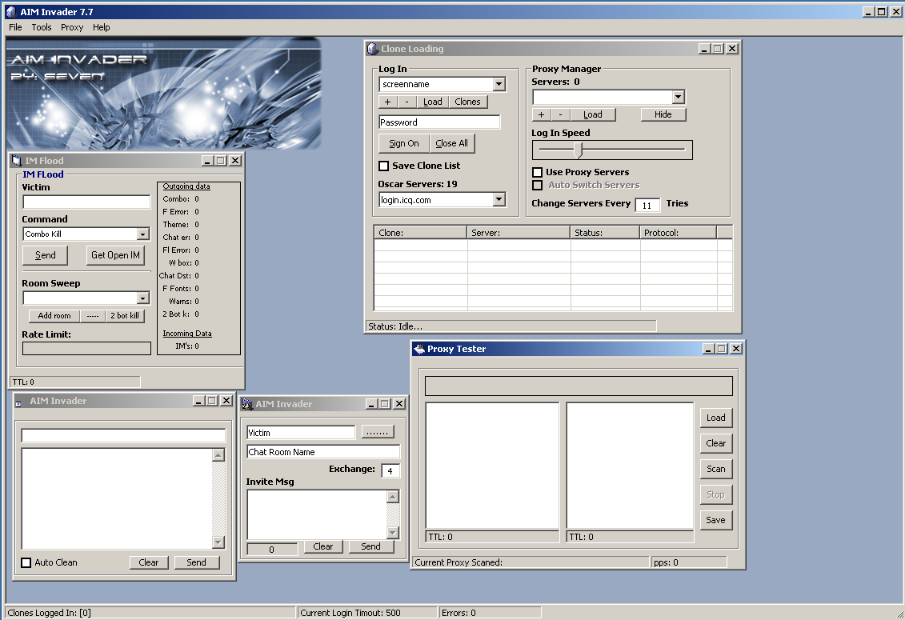</td>
<td align="center" valign="top"><b>AIM Invader Pro</b>  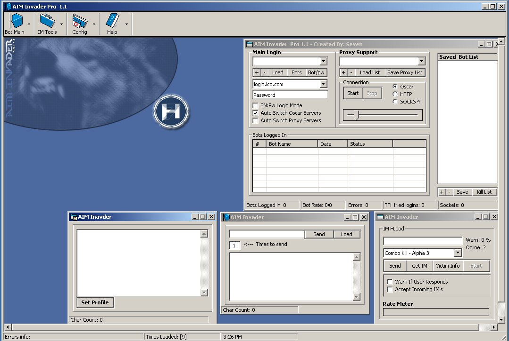</td>
</tr>
<tr>
<td align="center" valign="top"><b>AIM Invader Shadow</b>  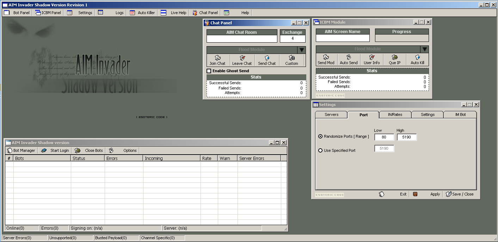</td>
<td align="center" valign="top"><b>AIM Invader iSpec</b>  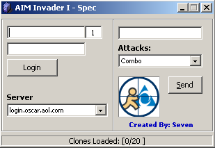</td>
</tr>
<tr>
<td align="center" valign="top"><b>AIWin (AIM Invader Winsock 3.5)</b>  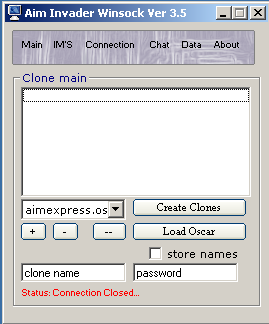</td>
<td align="center" valign="top"><b>AI Mass Flux</b>  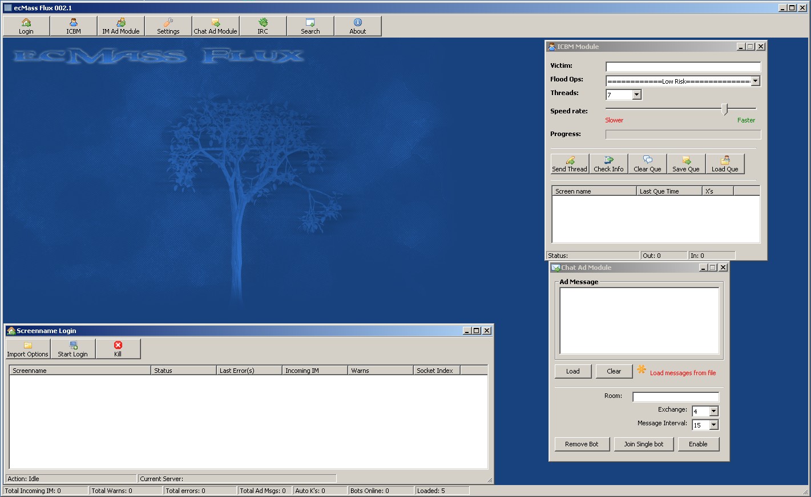</td>
</tr>
<tr>
<td align="center" valign="top"><b>AIM Boss</b>  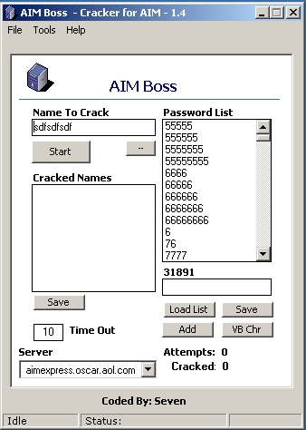</td>
<td align="center" valign="top"><b>AIM Unlimited</b>  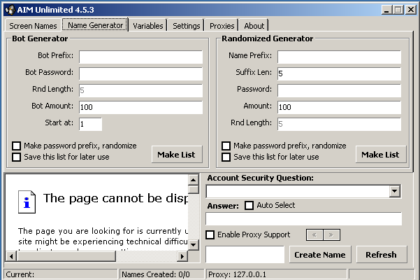</td>
</tr>
<tr>
<td align="center" valign="top"><b>Private Cracker</b>  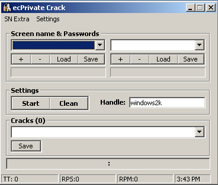</td>
<td align="center" valign="top"><b>Subterfuge</b>  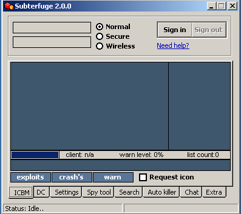 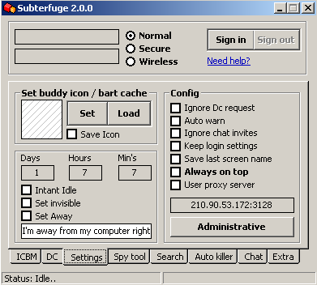</td>
</tr>
<tr>
<td align="center" valign="top"><b>TOC Clone</b>  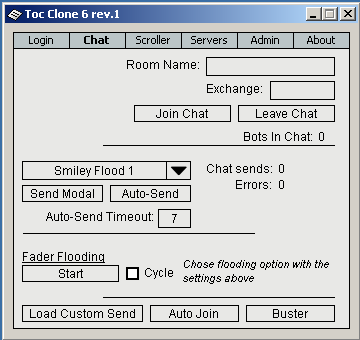</td>
<td align="center" valign="top"><b>eClone</b>  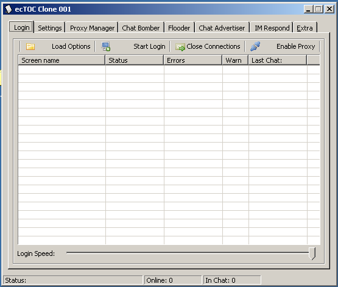</td>
</tr>
<tr>
<td align="center" valign="top"><b>ecAdmin</b>  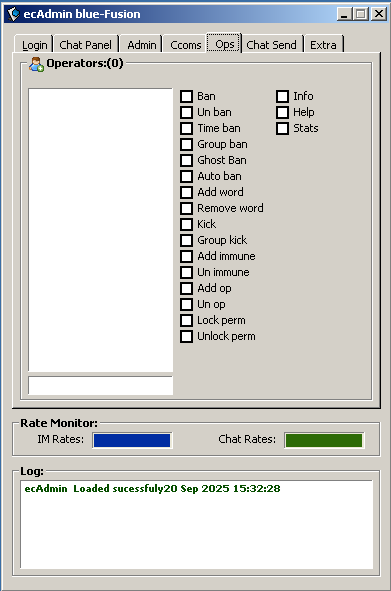 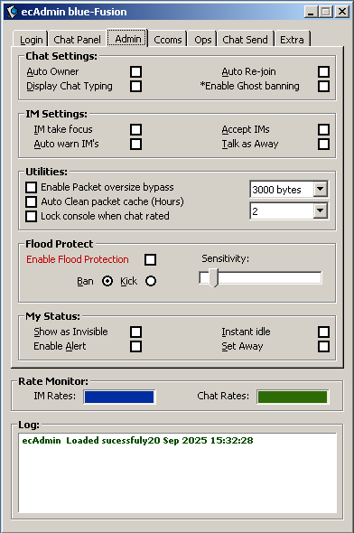  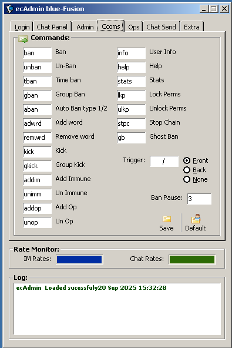 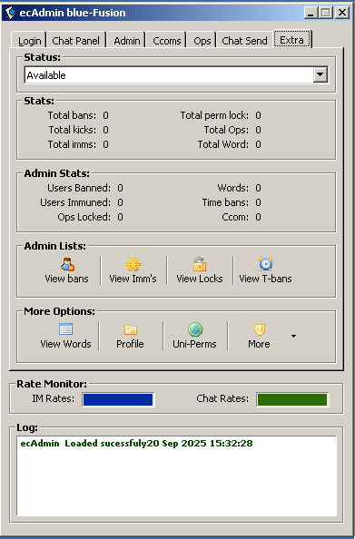</td>
<td align="center" valign="top"><b>scBlue</b>  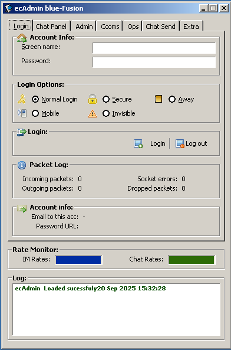</td>
</tr>
<tr>
<td align="center" valign="top"><b>Bot Config</b>  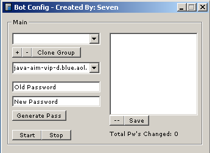</td>
<td align="center" valign="top"><b>HiFive Collector</b>  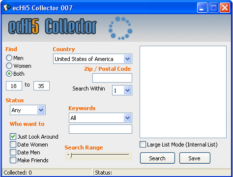</td>
</tr>
<tr>
<td align="center" valign="top"><b>Nuntius</b>  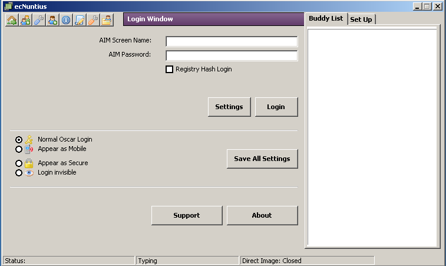</td>
<td align="center" valign="top"><b>Warn Mod</b>  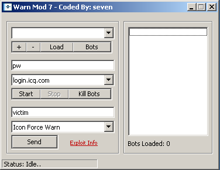</td>
</tr>
<tr>
<td align="center" valign="top"><b>Porn Block</b>  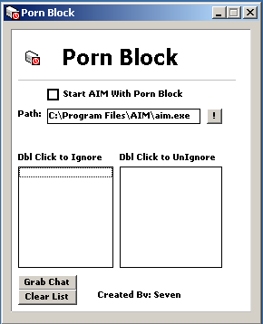</td>
<td align="center" valign="top"><b>YT Comment</b>  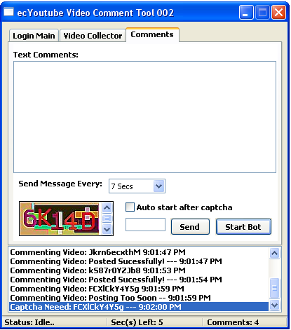</td>
</tr>
</table>

## Source code

Source for these tools is being added to [`/source`](source/) as it's recovered from old drives. Snippets already published are browsable at **[sevlegend.com/?page=codes](https://sevlegend.com/?page=codes)**.

## Historical note

These programs are preserved as **internet history**. AOL's AIM service shut down in December 2017, so none of this connects to anything today. Nothing here should be pointed at a live service.

## More

- 🌐 **[sevlegend.com](https://sevlegend.com)**: the full archive
- 🎙️ **[AOL Underground podcast](https://aolunderground.com/)**: interviews with the people of the AOL/AIM scene, including Seven
- 💬 Questions, memories, or screenshots of your own old progs? Open an issue.

© Seven Legend · <a href="https://sevlegend.com">sevlegend.com</a>

